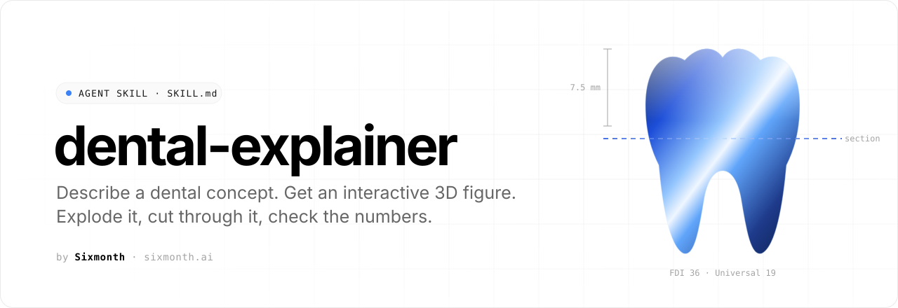
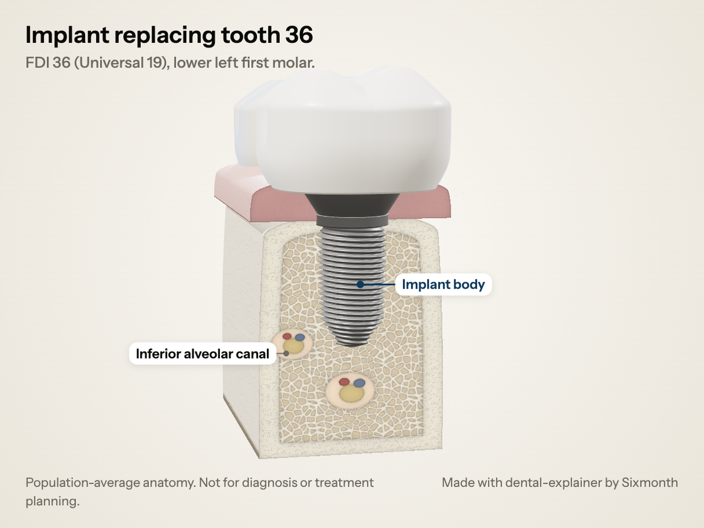
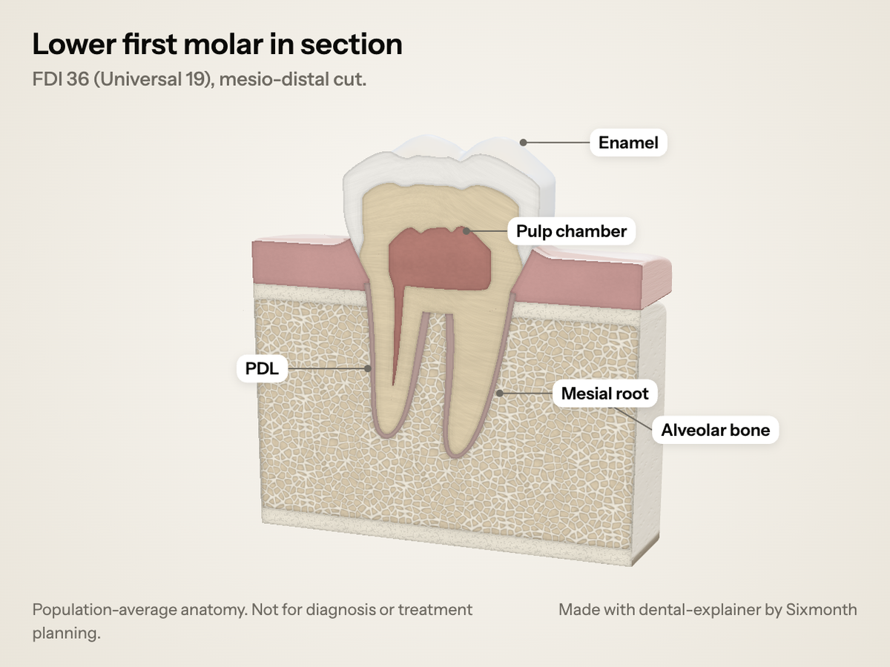
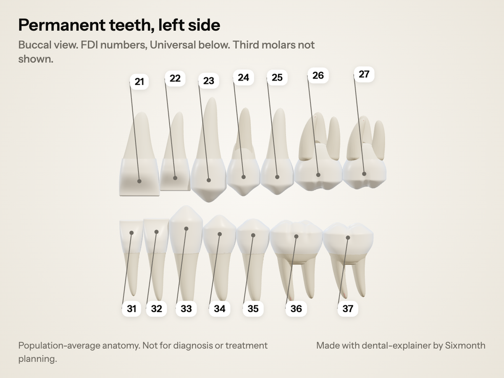
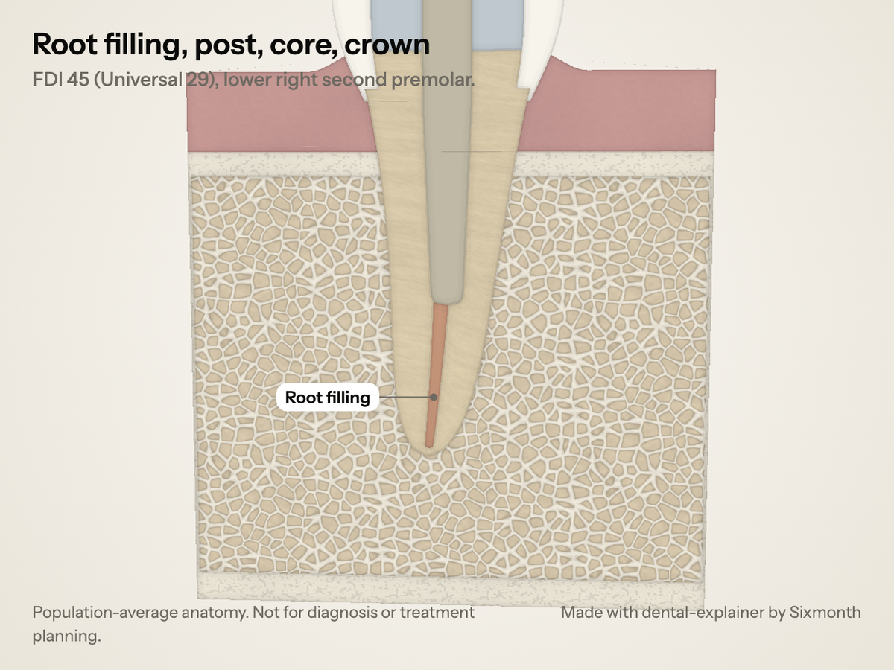
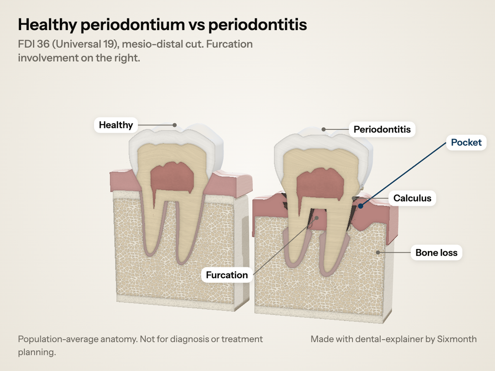
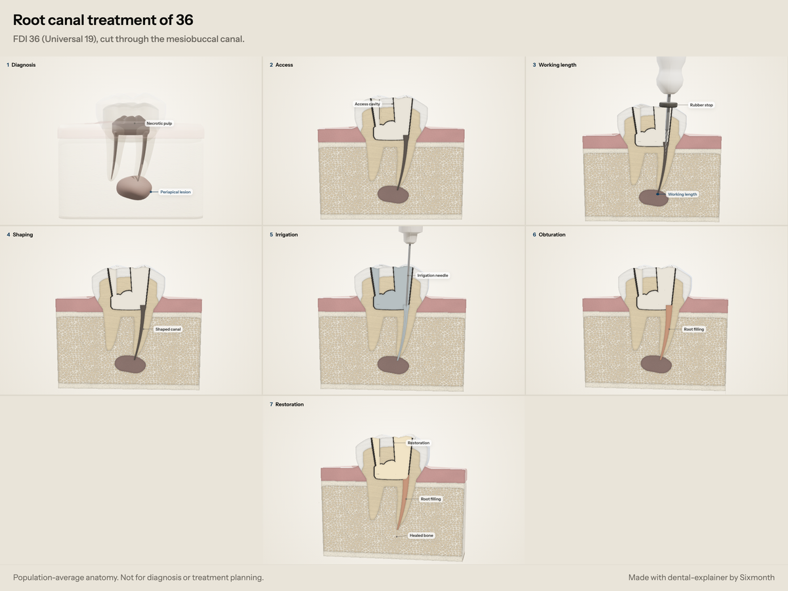
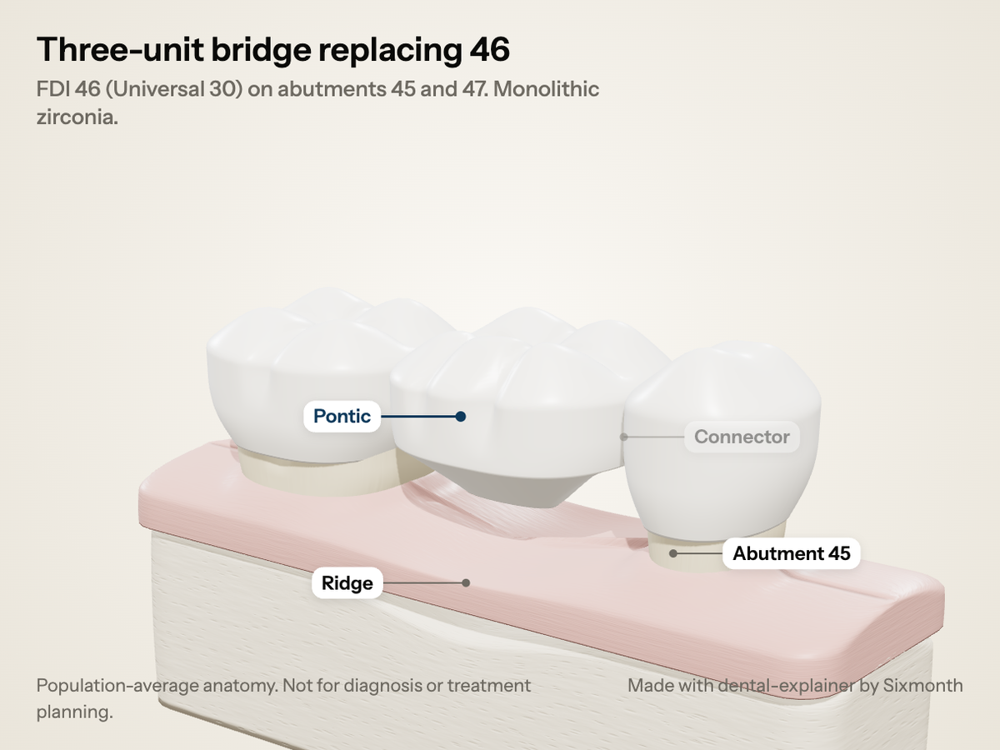
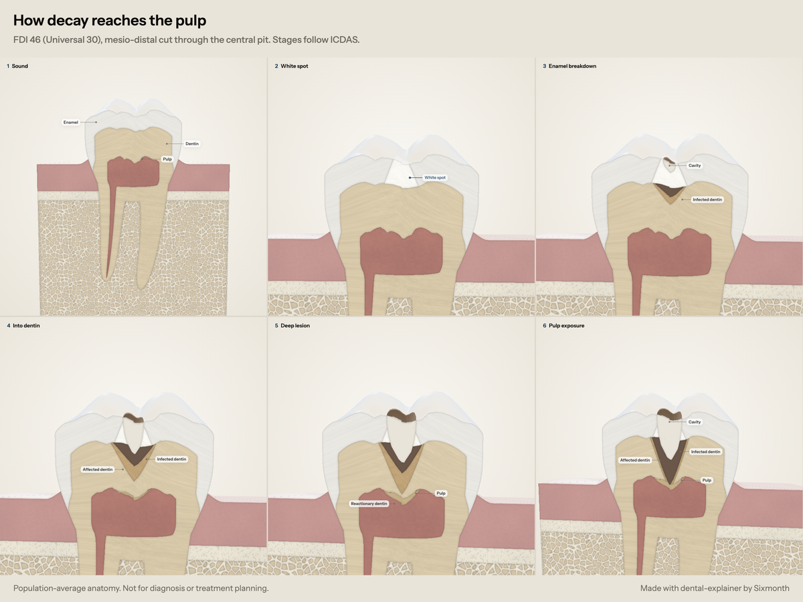

<p align="center">
  <picture>
    <source media="(prefers-color-scheme: dark)" srcset=".github/assets/banner-dark.svg">
    
  </picture>
</p>

<p align="center">
  <a href="#install"></a>
  <a href="#install"></a>
  <a href="LICENSE"></a>
  <a href="https://sixmonth.ai"></a>
</p>

<p align="center">
  <b>An open agent skill that turns any dental concept into an accurate 3D figure.</b><br>
  Get it as an image or an interactive page you can rotate, explode and cut through. Video clips are coming soon.<br>
  Built from real millimetre dimensions and checked against a verified dental facts file.
</p>

<p align="center">
  <a href="#install">Install</a> ·
  <a href="#gallery">Gallery</a> ·
  <a href="#why-it-exists">Why</a> ·
  <a href="#how-it-works">How it works</a> ·
  <a href="https://sixmonth.ai/offchair">Newsletter</a>
</p>

<br>

## Install

`dental-explainer` follows the open [Agent Skills](https://agentskills.io) format. The skill lives in [`skills/dental-explainer/`](skills/dental-explainer), a folder with a `SKILL.md` at its root, and the repo doubles as a plugin marketplace for Claude, ChatGPT and Codex.

**Claude (web & desktop app): no download needed**

1. Open **Customize → Plugins → Add marketplace**.
2. Paste `sixmonth-ai/dental-explainer`.
3. Find **Dental Explainer** and click **Install**.

It updates automatically when the repo changes. For screenshots and page assembly, turn on code execution in **Settings → Capabilities**.

| Where | How |
|---|---|
| **Claude Code** | `/plugin marketplace add sixmonth-ai/dental-explainer`, then `/plugin install dental-explainer@sixmonth` |
| **Codex, ChatGPT desktop app** | `codex plugin marketplace add sixmonth-ai/dental-explainer`, then `codex plugin add dental-explainer@sixmonth`. In the ChatGPT desktop app, restart it and install **Dental Explainer** from the **Sixmonth** source in the Plugins Directory. |
| **Cursor, OpenCode, Copilot, Gemini CLI** | `npx skills add sixmonth-ai/dental-explainer` |
| **ChatGPT on the web** (plans with Skills), or Claude by ZIP | Download **[`dental-explainer.zip`](https://github.com/sixmonth-ai/dental-explainer/releases/latest/download/dental-explainer.zip)** and upload it as is (don't unzip it). ChatGPT: **Skills → Create → Upload from your computer**. Claude: **Settings → Capabilities → Skills → Upload a skill**. |
| **Manual** | `git clone https://github.com/sixmonth-ai/dental-explainer.git && cp -r dental-explainer/skills/dental-explainer ~/.claude/skills/` |

**What it runs and fetches.** Figures load three.js r128 from cdnjs.cloudflare.com, and each figure's footer links to sixmonth.ai. The optional scripts (Python, headless Chromium) run locally, and only when the agent has code execution. The skill sends no data anywhere.

Then ask for a dental visual in plain words. The agent asks which format you want (image or interactive) unless you say, and asks what to show only when the request is vague. You can also call it by name: `/dental-explainer` in Claude, `$dental-explainer` in Codex.

```text
Show an exploded view of an implant replacing 36
Why does MB2 get missed in upper first molars? Cut through the tooth
Healthy lower molar vs periodontitis, with furcation involvement
Root-filled premolar with fibre post, core and crown, for patients
How does a cavity reach the nerve? For a patient, as an image
Mixed dentition of an 8-year-old, lower left
```

**What it covers.** Permanent and primary teeth (every FDI position, real third molars, impactions), numbering charts (FDI, Universal, Palmer) and arches, tooth anatomy in section, implants, crown preparations, bridges, veneers, inlays and onlays, posts and cores, caries and fillings, periodontal disease and probing, root canal treatment and endodontic instruments, braces, aligners and tooth movement.

<br>

## Gallery

Every figure below was made by the skill, shown here in image mode. The same script also opens as an interactive page; the sources and pages are in [`examples/`](skills/dental-explainer/examples).

<table>
  <tr>
    <td width="50%" valign="top">
      <picture><source media="(prefers-color-scheme: dark)" srcset=".github/assets/fig-implant-dark.png"></picture>
      <br><b>Implant replacing 36</b><br><sub>Exploded stack and a CBCT-style cut. Readouts check ≥1.5 mm to the neighbouring roots and ≥2 mm above the canal.</sub>
    </td>
    <td width="50%" valign="top">
      <picture><source media="(prefers-color-scheme: dark)" srcset=".github/assets/fig-molar-dark.png"></picture>
      <br><b>First molar in section</b><br><sub>Slide the cut bucco-lingually to find the MB and ML canals of the mesial root.</sub>
    </td>
  </tr>
  <tr>
    <td width="50%" valign="top">
      <picture><source media="(prefers-color-scheme: dark)" srcset=".github/assets/fig-dentition-dark.png"></picture>
      <br><b>Permanent teeth, left side</b><br><sub>Seen from the left cheek, built to Wheeler averages, FDI with Universal below. Three roots upper, two roots lower.</sub>
    </td>
    <td width="50%" valign="top">
      <picture><source media="(prefers-color-scheme: dark)" srcset=".github/assets/fig-restorative-dark.png"></picture>
      <br><b>Root filling, post, core, crown</b><br><sub>What each layer does, with a 2 mm ferrule and ≥4 mm apical seal checked in the readout.</sub>
    </td>
  </tr>
  <tr>
    <td width="50%" valign="top">
      <picture><source media="(prefers-color-scheme: dark)" srcset=".github/assets/fig-perio-dark.png"></picture>
      <br><b>Healthy vs periodontitis</b><br><sub>One shared cut. Bone loss, pocket depth and attachment loss computed from the same numbers; furcation Class III, calculus, recession.</sub>
    </td>
    <td width="50%" valign="top">
      <picture><source media="(prefers-color-scheme: dark)" srcset=".github/assets/fig-endo-dark.png"></picture>
      <br><b>Root canal treatment of 36</b><br><sub>Access, working length 0.5 mm short of the apex, shaping to 25/.06, irrigation, obturation, restoration, healing.</sub>
    </td>
  </tr>
  <tr>
    <td width="50%" valign="top">
      <picture><source media="(prefers-color-scheme: dark)" srcset=".github/assets/fig-bridge-dark.png"></picture>
      <br><b>Three-unit bridge replacing 46</b><br><sub>Retainers seat exactly on the preps; the connector is labelled with its cross-section against the material's minimum.</sub>
    </td>
    <td width="50%" valign="top">
      <picture><source media="(prefers-color-scheme: dark)" srcset=".github/assets/fig-caries-dark.png"></picture>
      <br><b>How decay reaches the pulp</b><br><sub>ICDAS stages from white spot to pulp exposure; selective removal leaves the firm, affected dentin.</sub>
    </td>
  </tr>
</table>

<br>

## Why it exists

AI models are fluent about dentistry and often wrong about it. `dental-explainer` gives the agent a verified [facts file](skills/dental-explainer/references/dental-facts.md) to work from, plus a checklist it runs before every figure.

| Models often… | The skill knows |
|---|---|
| say adults have 28 teeth | 32 permanent teeth including third molars; 20 primary teeth, no primary premolars |
| treat FDI 36 and Universal 36 as the same tooth | FDI 36 = Universal 19, and Universal stops at 32 |
| draw every molar with three roots | maxillary molars have 3 roots, mandibular molars 2 |
| give the upper first molar three canals | MB2 is present in about 57–74% of upper first molars |
| say enamel grows back | enamel is acellular; only early lesions remineralise |
| quote one torque for all implants | torque is manufacturer-specific |

Values carry their sources. Anything not yet checked against a source is tagged **[U]**.

<br>

## How it works

1. **Ask.** Image or interactive? If the request is vague, what should it show (for a procedure, it proposes the steps first).
2. **Teaching point.** The agent pins down the one idea the figure must show.
3. **Facts.** It looks up the numbers in the facts file instead of guessing.
4. **Plan.** Parts with real sizes in millimetres, the cut planes, and a short story of camera moves that ends on the shot that answers the question. Every piece of text has to earn its place. Procedures (placing an implant, shaping a canal) become named clinical steps: a stepper on the page or a numbered storyboard image.
5. **Build.** A short script against the bundled three.js drawing kit, with ready-made teeth for every FDI position (primary teeth too), implants, crowns, bridges, veneers, fillings, posts, endodontic files, brackets, aligners, bone, gingiva and periodontal defects.
6. **Verify and deliver.** Where a browser is available, it renders the PNG (or screenshots the page), looks at it, and fixes what's wrong.

```
dental-explainer/
├── .claude-plugin/
│   ├── plugin.json              plugin manifest
│   └── marketplace.json         lets Claude add this repo as a marketplace
└── skills/dental-explainer/
    ├── SKILL.md                 the workflow the agent follows
    ├── references/
    │   ├── dental-facts.md      verified values and sources: the correction layer
    │   └── kit-api.md           drawing-kit reference
    ├── assets/dentkit.js        3D kit (loads three.js r128 from cdnjs)
    ├── examples/                finished figures across every topic, .js source and .html pages
    └── scripts/                 build.py (assemble a page) · render.py (PNG, GPU when available) · check.py (screenshot and error check)
```

<br>

## Limits

- **Video is coming soon.** Today the skill makes images and interactive pages; interactive pages play the same walkthrough on load.
- Figures use population-average anatomy. They are not patient-specific: no CBCT or STL import.
- Implants are generic (correct diameter, length and connection type). No brand geometry.
- For education and communication only, not for diagnosis or treatment planning.

<br>

## Stay up to date

`dental-explainer` is made by **[Sixmonth](https://sixmonth.ai)**. Get a weekly briefing on AI in dentistry at **[sixmonth.ai/offchair](https://sixmonth.ai/offchair)**.

<sub>MIT licensed. Concept inspired by the open-source <a href="https://github.com/wheresryan22/anatomy">Anatomy</a> skill by @wheresryan22; the dental kit, facts file and figures here are original work. three.js © its authors, MIT.</sub>
